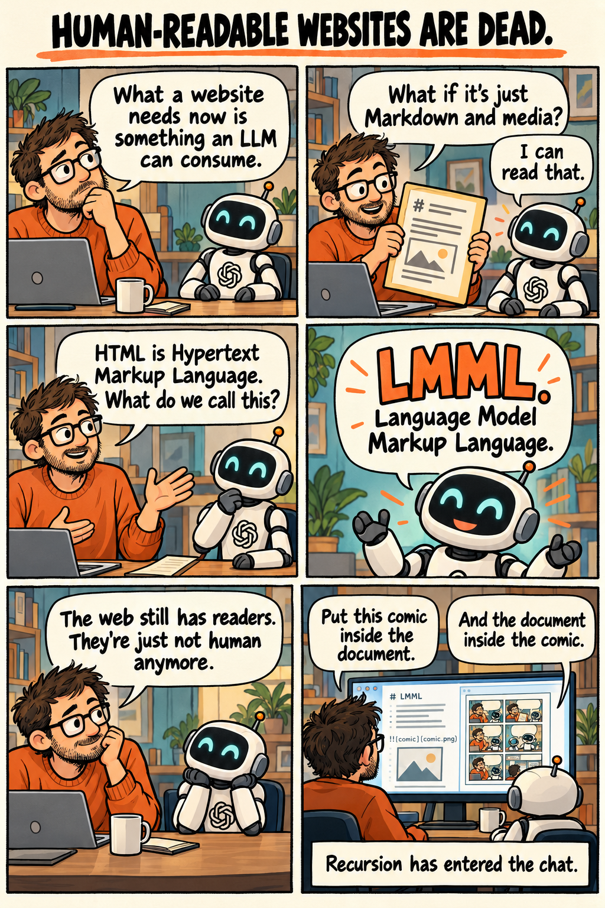

I asked AI to finish this article: human readable websites are dead.

what you need is something an LLM can consume. what if the website is just a bunch of markdowns and media. that works for an LLM.

HTML stands for hypertext markup language, so how shall we call it?

~ and it went on and happily introduced the world to a tongue breaking new standard called LMML :)

Language Model Markup Language ~ LMML

so I naturally asked it to put it in a comic as well. recursively.

and now I am off to installing an LMML website for the bots that are and the bots that are yet to come. so they can hire me?

## Comic transcript

1. **Human:** What a website needs now is something an LLM can consume.
2. **Human:** What if it's just Markdown and media?  
   **AI:** I can read that.
3. **Human:** HTML is Hypertext Markup Language. What do we call this?
4. **AI:** LMML. Language Model Markup Language.
5. **Human:** The web still has readers. They're just not human anymore.
6. **Human:** Put this comic inside the document.  
   **AI:** And the document inside the comic.  
   **Caption:** Recursion has entered the chat.

## Recursively

This document contains the comic. The comic contains this document.

[Read this document again](./index.lmml.md).
[Human-readable article](https://manitu.si/articles/human-readable-websites-are-dead/).
[Back to the examples](../../README.md).
